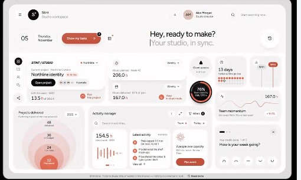

# PRD Website UD Grating Sejahterah

**Acuan implementasi · 20 November 2026 · Bahasa antarmuka Indonesia**

UD Grating Sejahterah adalah bengkel di Sidoarjo yang menawarkan steel grating dan jasa fabrikasi besi. Calon pelanggan perlu melihat hasil pekerjaan, memeriksa apakah ukuran dan finishing cocok dengan kebutuhan proyek, lalu meminta harga untuk beberapa item sekaligus. Admin perlu menerima daftar yang sama persis dengan yang dilihat pelanggan dan dapat menindaklanjutinya melalui WhatsApp.

**Ukuran keberhasilan demo:** pelanggan memasukkan dua produk dengan jumlah berbeda, mengajukan satu permintaan penawaran (*Request for Quotation*, RFQ), lalu membuka WhatsApp. ID dan kedua baris item di pesan cocok dengan detail yang dilihat admin. Admin dapat mengubah status dan melihat hasilnya kembali setelah memuat ulang halaman.

## 1. Dasar keputusan dan kesiapan

Kebutuhan cukup jelas untuk memulai desain dan pembangunan. Gunakan matriks SRS revisi beserta SDD revisi di bawah sebagai acuan perilaku. Arah visual mengikuti gambar yang diberikan pengguna. Pilihan tata letak, warna, dan perilaku yang mengisi celah dokumen diberi penanda **usulan**. Review desain formal oleh tim dan mitra masih terbuka.

| Perbedaan yang memengaruhi implementasi | Keputusan untuk agent |
|---|---|
| Sampul SRS Markdown masih menyebut v1.1, sementara riwayat mencatat v1.2 pada 19 November 2026. Beberapa paragraf dan diagram lama hanya menyebut 10–11 kebutuhan. | Gunakan 15 kebutuhan dan 16 use case di matriks revisi. P2 tetap termasuk rilis yang direncanakan. |
| SDD awal menghubungkan satu pengajuan langsung ke satu produk dan masih membuka pilihan basis data. | Ikuti SDD revisi. Gunakan MySQL, satu header RFQ dan satu atau lebih baris item. |
| Proposal merinci halaman publik. SRS menyebut drawer/modal dan SDD mengelompokkan beberapa tampilan di bawah satu kode UI. | **Usulan:** detail, keranjang dan checkout memiliki URL sendiri agar dapat dipakai di ponsel serta mendukung tombol Kembali. Ringkasan keranjang desktop boleh berupa drawer yang mengarah ke halaman yang sama. |
| Referensi visual menampilkan dashboard studio dengan aktivitas tim dan grafik waktu kerja. | Ambil komposisi kartu, tipografi dan aksen warnanya. Isi dashboard berasal dari pekerjaan bengkel dan data RFQ di sistem. |

## 2. Pengguna dan lingkup rilis

| Pengguna | Pekerjaan utama | Titik selesai |
|---|---|---|
| Pengunjung, termasuk kontraktor, bagian pengadaan, dan pembeli perorangan | Menilai kemampuan bengkel, memilih produk/jasa, meminta harga atau berkonsultasi untuk ukuran khusus tanpa login | Mendapat ID pengajuan dan draf pesan WhatsApp berisi itemnya, atau membuka percakapan konsultasi langsung |
| Admin bengkel | Menjaga katalog dan profil tetap akurat, menerbitkan dokumentasi proyek dan menindaklanjuti RFQ | Perubahan konten muncul di halaman publik dan status RFQ tersimpan di panel admin |

**Batas rilis.** Harga final, ongkos kargo, kesepakatan pekerjaan dan pembayaran ditangani melalui komunikasi dengan bengkel. Payment gateway, akun pelanggan, peran Owner terpisah, aplikasi seluler native, akuntansi, penggajian, dan inventaris bahan baku berada di luar lingkup. Stok katalog menunjukkan ketersediaan yang diperbarui admin.

## 3. Peta halaman dan arah visual

**Arah desain setelah revisi.** Navigasi bertingkat, urutan aplikasi dan katalog, serta hierarki spesifikasi mengambil acuan dari [GKD Group](https://www.gkd-group.com/en/architecture/products/). Gunakan identitas visual UD Grating Sejahterah dengan palet hijau abu-abu dan terakota, tipografi DM Sans, foto grating, dan garis pemisah tipis.

| Halaman | Susunan dan tindakan utama |
|---|---|
| Beranda · UI-01 | Header memisahkan lokasi dan kontak, menu utama dengan Keranjang, serta kategori produk dari katalog. Pada desktop, judul “Steel grating & fabrikasi besi”, pengantar, dan **Lihat katalog** menempati panel hijau gelap di sebelah foto panel galvanis. Lanjutkan dengan aplikasi grating menurut kategori, contoh penerapan, ringkasan profil dan konsultasi. |
| Profil dan Kontak · UI-01 | Sajikan sejarah, visi-misi, kapasitas, informasi mutu dan legalitas yang dapat dibuktikan. Tampilkan alamat, tautan lokasi Google Maps, email dan tombol WhatsApp dari data resmi. Beranda menampilkan ringkasannya. |
| Katalog dan detail · UI-02 | Tampilkan pengantar material, jejak navigasi, pencarian dan filter sebelum grid. Setiap entri menyandingkan foto dengan ringkasan kategori, permukaan, dimensi, finishing, ketersediaan, dan harga yang tersedia. Pada detail desktop, sandingkan tabel spesifikasi dengan foto produk. Kelompokkan harga dan **Tambah ke keranjang** dalam panel pemesanan, serta tampilkan **Konsultasi ukuran khusus** di dekat foto. |
| Portofolio · UI-03 | Galeri foto hasil pekerjaan. Detail proyek berisi lingkup, waktu pengerjaan, dokumentasi, serta lokasi atau klien apabila diizinkan untuk ditampilkan. |
| Keranjang · UI-06 → Checkout · UI-04 | Keranjang menampilkan setiap baris item, jumlah, aksi hapus dan subtotal yang dapat dihitung. Checkout menempatkan identitas dan alamat di sebelah ringkasan pada desktop. Di ponsel, tampilkan keduanya berurutan sebelum **Ajukan penawaran dan buka WhatsApp**. |
| Login dan dashboard admin · UI-05 | Setelah login, sidebar berlabel memuat Ringkasan, Produk & Jasa, Kategori, Portofolio, RFQ, Profil Usaha dan Keluar. Satukan metrik RFQ baru, jumlah produk, dan jumlah proyek dalam satu baris. Berikan ruang terbesar ke tabel RFQ terbaru. **Lihat RFQ** membuka daftar, **Tambah produk** membuka formulir. |
| Pengelolaan dan tindak lanjut · UI-05 / UI-07 | Daftar konten mengarah ke formulir edit. Daftar RFQ berurutan dari terbaru, dengan filter status. Detail menyatukan ID, waktu, kontak, alamat, catatan, semua item, dan kontrol **Simpan status**. |

**Pedoman visual**

- Gunakan latar seperti kertas `#F6F6F2`, tinta dan tombol utama `#202522`, teks sekunder `#535B55` dan aksen terakota `#A04834` untuk navigasi aktif dan fokus. Gunakan garis batas tipis, sudut kecil dan status berupa label teks yang terbaca.
- Gunakan DM Sans atau sans-serif sistem. Utamakan teks isi sekitar 16 px, satuan teknis yang terbaca dan angka rata kanan pada kolom jumlah atau harga. Sisakan ruang di antara grup data. Tombol utama harus mudah ditemukan pada setiap langkah.
- Beri foto grating cukup ruang untuk memperlihatkan permukaan polos atau bergerigi. Pakai rasio foto katalog yang konsisten. Beri penanda pada ilustrasi demo dan gunakan dokumentasi resmi setelah tersedia. Sajikan ukuran dan finishing sebagai teks yang bisa disalin pembeli ke dokumen pengadaan.
- Pada lebar 360 px, susun formulir satu kolom, ringkas filter dalam panel dan ubah sidebar admin menjadi menu berlabel. Pastikan kontrol jumlah, status dan tombol lanjut tetap terjangkau. Uji sampai 1920 px, dengan fokus keyboard terlihat, label formulir permanen, teks alternatif foto dan galat di dekat isian.
- Sediakan keadaan memuat, kosong, tanpa hasil, gagal dan berhasil sesuai halaman. Pada hasil pencarian kosong, pertahankan filter dan tawarkan **Atur ulang filter**. Saat belum ada RFQ, tampilkan pesan kosong dan angka 0 berdasarkan data aktual.

## 4. Kebutuhan dan kriteria penerimaan

P1 membentuk alur inti demo. P2 melengkapi rilis setelah P1 stabil. Kode FR dan UC merujuk ke matriks SRS revisi.

| ID | Prioritas | Perilaku yang harus dapat dibuktikan |
|---|---|---|
| FR-01 · UC-01 | P1 | Pengunjung membuka profil tanpa login, membaca kapasitas dan keterangan mutu yang tersedia, serta membuka titik workshop dari alamat resmi. |
| FR-02 · UC-02/03 | P1 | Pencarian kata kunci dapat dipadukan dengan filter kategori dan tipe permukaan plain/serrated. Hasil hanya memuat item aktif yang cocok. Menghapus filter memulihkan hasil yang relevan. |
| FR-03 · UC-04 | P1 | Detail grating menampilkan foto, dimensi, ukuran/ketebalan bearing bar, jarak pitch, finishing, satuan harga dan ketersediaan. Untuk jasa, tampilkan spesifikasi layanan yang relevan. Harga tetap dan harga kustom dapat dibedakan. |
| FR-04 · UC-05 | P1 | Pengunjung dapat menyimpan minimal dua item di sesi browser, mengubah jumlah masing-masing dan menghapus salah satunya. Setelah refresh pada sesi yang sama, isi keranjang masih tersedia. |
| FR-05 · UC-06 | P1 | Nama, nomor WhatsApp, alamat pengiriman dan seluruh item valid menghasilkan satu RFQ baru. Catatan pengajuan dan catatan per item bersifat opsional. WhatsApp terbuka setelah penyimpanan berhasil. |
| FR-06 · UC-07 | P2 | Tombol konsultasi membuka chat langsung dengan teks pembuka tentang kebutuhan kustom. Dari detail produk, cantumkan nama produk sebagai konteks. Keranjang dapat tetap dipakai setelah konsultasi. |
| FR-07 · UC-08 | P1 | Kredensial benar membuka dashboard. Login gagal menampilkan galat. Akses halaman admin tanpa sesi menuju login, API admin menolak permintaan, dan logout mengakhiri sesi. |
| FR-08 · UC-09 | P1 | Admin dapat menambah, melihat, mengubah, dan menonaktifkan produk/jasa. Penonaktifan mengeluarkan item dari katalog serta pengajuan baru dan mempertahankan riwayat lama. |
| FR-09 · UC-10 | P1 | Admin dapat mengunggah dan mengganti foto. Server menerima JPEG/PNG hingga 2 MB per berkas, menolak format atau ukuran lain dengan alasan yang terlihat, dan menampilkan foto tersimpan di katalog. |
| FR-10 · UC-11 | P1 | Admin menambah, mengganti nama dan menghapus kategori. Filter publik mengikuti perubahan. **Usulan:** kategori yang masih terpakai dapat dihapus setelah produknya dipindahkan. |
| FR-11 · UC-12 | P1 | Daftar menampilkan RFQ terbaru lebih dulu. Membuka satu ID menampilkan identitas, alamat, status, catatan dan seluruh item beserta jumlah pada saat diajukan. |
| FR-12 · UC-13 | P2 | Pengunjung membuka galeri dan detail proyek yang telah dipublikasikan. |
| FR-13 · UC-14 | P2 | Admin dapat menambah, mengubah dan menghapus proyek beserta fotonya. Galeri publik mencerminkan hasil simpan. Foto proyek mengikuti batas JPEG/PNG 2 MB. |
| FR-14 · UC-15 | P1 | Admin dapat memilih status RFQ yang sah, menyimpannya, dan melihat status baru setelah memuat ulang daftar atau detail. |
| FR-15 · UC-16 | P2 | Admin dapat mengubah profil dan kontak usaha. Ringkasan beranda serta halaman profil/kontak menampilkan perubahan tersimpan. |

## 5. Aturan katalog dan pengajuan

1. **Ketersediaan.** Katalog membedakan `PRODUK` dan `JASA`, serta `TERSEDIA`, `PRE_ORDER` dan `HABIS`. **Usulan:** item aktif berstatus pre-order dapat diajukan dengan label “Pre-order”. Item habis tetap dapat dilihat tetapi tombol tambah dinonaktifkan. Periksa kembali ketersediaan saat menyimpan RFQ.
2. **Harga.** Tampilkan Rupiah dan satuan yang dipakai bengkel. Untuk `TETAP`, estimasi baris adalah kuantitas × harga satuan. Untuk `CUSTOM`, simpan harga kosong dan tampilkan “Sesuai penawaran”. Dalam keranjang campuran, beri label “Subtotal item harga tetap” dan sebutkan item yang masih menunggu penawaran. Jika semuanya kustom, tampilkan keterangan penawaran untuk seluruh pengajuan.
3. **Validasi.** Wajib ada minimal satu item, jumlah bulat positif per baris, nama, nomor WhatsApp yang valid dan alamat pengiriman. Server mengambil identitas, nama dan harga item dari katalog berdasarkan ID yang diminta. Saat item sudah tidak tersedia, tandai baris bermasalah agar pembeli bisa memperbaiki keranjang.
4. **Penyimpanan.** Simpan header berstatus `BARU` dan seluruh item dalam satu transaksi MySQL. Simpan salinan nama dan harga satuan saat pengajuan dibuat. Kegagalan salah satu baris membatalkan seluruh transaksi. Keranjang dan isian dipertahankan untuk percobaan ulang.
5. **Kirim ulang.** Gunakan satu kunci idempotensi untuk upaya pengajuan yang sama, termasuk ketika koneksi putus setelah server menyimpan data. Muatan identik dengan kunci yang sama mengembalikan ID lama. Muatan yang berubah memakai kunci baru. Server menolak penggunaan ulang kunci untuk muatan berbeda.
6. **WhatsApp.** Setelah server mengonfirmasi penyimpanan, buka Click-to-Chat ke nomor penjualan resmi dengan teks terenkode yang memuat ID RFQ dan seluruh nama item serta jumlahnya. Pengunjung menekan Kirim di WhatsApp. **Usulan:** tampilkan “Permintaan #… tersimpan” dan **Buka WhatsApp lagi** apabila aplikasi gagal terbuka. Tombol itu menggunakan RFQ yang sama.
7. **Tindak lanjut.** Status sah terdiri dari `BARU`, `PENAWARAN_DIKIRIM`, `DIPROSES`, `SELESAI`, dan `BATAL`. Hanya admin dapat mengubah status. Dokumen menentukan daftar nilai. Urutan perpindahan wajib masih perlu keputusan bengkel.

## 6. Kontrak implementasi

Gunakan satu aplikasi **Next.js App Router, JavaScript, Tailwind CSS, Route Handlers pada Node.js LTS, dan MySQL**. Simpan unggahan di direktori persisten. Untuk detail tipe kolom dan wireframe, lihat SDD serta Draw.io yang ditautkan di akhir dokumen.

| Data | Tanggung jawab |
|---|---|
| `users`, `company_profiles` | Akun admin dengan hash kata sandi, identitas bengkel, profil dan informasi kontak. SDD menempatkan nomor tujuan RFQ di konfigurasi server. Pastikan nomor tujuan dan kontak yang dipublikasikan cocok saat menyiapkan rilis. |
| `categories`, `products` | Satu kategori memiliki banyak item. Simpan jenis produk/jasa, spesifikasi, jenis harga, nominal tetap bila relevan, status stok, foto dan status aktif. **Usulan:** simpan tipe permukaan tersendiri agar filter plain/serrated bekerja konsisten, serta satuan per item agar estimasi dapat dibaca dengan benar. |
| `portfolios` | Judul proyek, foto, deskripsi, tanggal selesai, identitas klien opsional dan informasi publikasi yang diperlukan galeri. |
| `inquiries`, `inquiry_items` | Header berisi pelanggan, kontak, alamat, catatan, status, waktu dan kunci unik. Tiap baris mengacu ke header serta produk dan menyimpan jumlah, salinan nama, salinan harga satuan, dan catatan opsional. |

| Metode dan rute dari SDD | Akses dan hasil |
|---|---|
| `POST /api/inquiries` | Publik. Header `Idempotency-Key` berisi UUID. Muatan berisi `customerName`, `customerPhone`, `shippingAddress`, `notes?`, dan `items[{productId, quantity, notes?}]`. Berhasil pertama kali mengembalikan 201 dengan `{id, status, whatsappUrl}`. Pengulangan identik 200, input salah 400, konflik kunci atau item tidak tersedia 409. |
| `GET /api/admin/inquiries` | Sesi admin. Daftar terbaru dengan filter status opsional. Berhasil 200, sesi tidak sah 401. |
| `GET /api/admin/inquiries/:id` | Sesi admin. Mengembalikan header dan seluruh item. Berhasil 200, sesi tidak sah 401, ID tidak ditemukan 404. |
| `PATCH /api/admin/inquiries/:id/status` | Sesi admin. Terima `{status}` dan kembalikan ID serta status tersimpan. Berhasil 200, nilai salah 400, sesi tidak sah 401, ID tidak ditemukan 404. |

**Kualitas dan operasional.** Target SRS adalah halaman publik termuat dalam ≤2,5 detik pada profil 4G yang disepakati, pencarian katalog <300 ms, serta 100 pengunjung bersamaan yang membaca katalog tanpa kegagalan aplikasi. Catat kondisi uji, ukuran katalog dan hasil pada staging. Target ketersediaan produksi 99% per bulan diukur setelah rilis. Validasi masukan dan sesi di server, gunakan kueri berparameter dan escaping teks, serta hash kata sandi dengan bcrypt berbiaya minimal 10. Akses detail pelanggan dibatasi kepada admin untuk tindak lanjut penawaran.

Rencana produksi menggunakan satu server Linux, reverse proxy HTTPS, MySQL privat dan kredensial melalui variabel lingkungan. Cadangkan basis data serta unggahan setiap hari ke penyimpanan terpisah. Verifikasi pemulihan dan jalankan uji alur utama pada staging sebelum rilis. Domain dan penyedia hosting masih terbuka.

## 7. Urutan pembangunan dan uji penerimaan

1. **Prototipe.** Tinjau beranda, detail grating, dan dashboard admin dalam ukuran ponsel dan desktop. Gunakan gambar referensi untuk menilai hierarki kartu. Minta calon pembeli menemukan ukuran dan meminta penawaran, lalu minta admin menemukan RFQ baru tanpa dipandu.
2. **Alur P1.** Bangun satu alur utuh dari katalog yang dikelola admin hingga RFQ muncul di detail admin. Gunakan dua item dengan jumlah berbeda dalam demo. Jalankan uji berikut sebelum menyatakan alur selesai.
3. **Pelengkap P2 dan rilis.** Sambungkan konsultasi langsung, galeri, pengelolaan proyek dan profil. Verifikasi pembaruan dari panel admin sampai halaman publik. Jalankan uji penerimaan bersama mitra dengan data produk serta kontak yang disetujui.

| Skenario uji | Bukti lulus |
|---|---|
| U-01 · RFQ campuran | Masukkan produk harga tetap ×2 dan item kustom ×3. Subtotal hanya menghitung produk harga tetap. Satu header dan dua baris tersimpan. ID, nama item dan jumlah cocok pada konfirmasi, pesan WhatsApp dan detail admin. |
| U-02 · Input dan kegagalan simpan | Coba keranjang kosong, jumlah 0, item yang dinonaktifkan sejak masuk keranjang, lalu simulasikan gagal simpan baris kedua. Tidak ada data parsial. WhatsApp tetap tertutup dan pelanggan dapat memperbaiki atau mengulang pengajuan. |
| U-03 · Kirim ulang | Ulangi permintaan identik dengan kunci sama, termasuk klik bersamaan. Hanya satu RFQ tercipta. Kunci sama dengan muatan berbeda ditolak. Membuka kembali WhatsApp mempertahankan ID pertama. |
| U-04 · Riwayat dan akses | Ubah nama/harga produk sesudah checkout. Detail lama mempertahankan nama dan harga pada saat pengajuan. Ubah status sebagai admin lalu muat ulang. Tanpa sesi, daftar, detail dan pembaruan status ditolak. |
| Konten dan perangkat | Dari admin, ubah kategori, foto produk, portofolio dan profil. Periksa hasil di publik, penolakan foto melebihi batas, serta keadaan katalog kosong. Selesaikan alur penawaran pada lebar 360 px dan desktop. |

## 8. Keputusan yang masih diperlukan dari mitra

| Yang perlu dipastikan | Pegangan selama pengembangan |
|---|---|
| Identitas publik dan kontak | Gunakan nama “UD Grating Sejahterah”. Minta logo resmi, alamat lengkap, titik Maps, email, dan nomor WhatsApp tujuan. Gunakan konfigurasi uji untuk demo. |
| Isi katalog dan bukti pekerjaan | Minta contoh produk/jasa lengkap dengan satuan jual, spesifikasi, harga atau penanda kustom, stok dan foto. Minta dokumentasi proyek yang boleh dipublikasikan. Gunakan data contoh berlabel pada prototipe. |
| Klaim mutu dan kapasitas | SRS menyebut pelapisan galvanis ASTM A123, legalitas dan kapasitas bengkel. Minta bukti dan cakupan per produk sebelum menayangkan klaim atau angka. Logo dalam media akademik adalah identitas kampus. |
| Aturan operasional dan persetujuan desain | Validasi perlakuan pre-order, perpindahan status, prioritas P1/P2 serta tampilan contoh dengan mitra. Setelah itu tetapkan profil pengujian 4G, domain, dan hosting untuk rilis. |

## Sumber lokal

- [SRS revisi dan matriks FR/UC](pti/Revisi%20Lokal/SRS%20Kelompok%203.md) dan [versi Word](pti/Revisi%20Lokal/SRS%20Kelompok%203.docx) memuat prioritas, kriteria penerimaan dan skenario U-01–U-04.
- [SDD revisi](pti/Revisi%20Lokal/Laporan_SDD_UD_Grating_Sejahterah_Kelompok_3.docx) dan [diagram desain revisi](pti/Revisi%20Lokal/Diagram%20Desain%20UD%20Grating%20Sejahterah.drawio) memuat kontrak API, model data, tujuh kelompok layar dan wireframe pengajuan.
- [Proposal revisi](pti/Revisi%20Lokal/PROPOSAL_PTI-UDGratingSEJAHTERAH.docx) dan [logbook revisi](pti/Revisi%20Lokal/Kelompok%203.docx) menjelaskan masalah usaha, batas proyek dan target demo.
- Dokumen tingkat atas dan [diagram Minggu 6](pti/Diagram%20Minggu%206/) memberi konteks versi awal. Berkas UTS berisi indeks dokumen. Bukti Google Docs, media hasil ekstraksi dan template SRS merupakan bahan akademik. [Gambar referensi dari pengguna](pti/referensi-visual.png) menjadi acuan tampilan.
