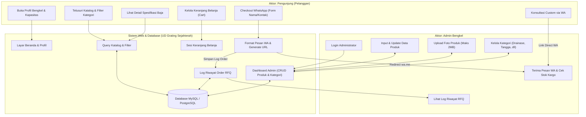
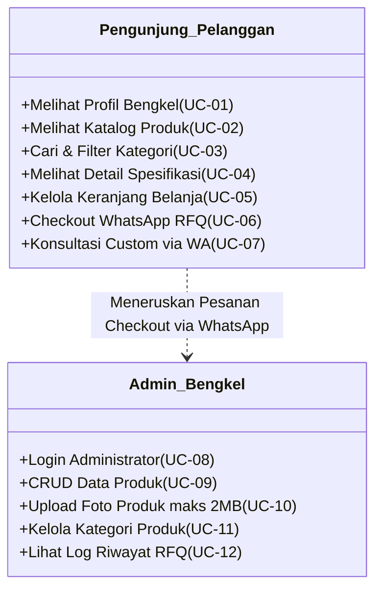

# Software Requirements Specification (SRS)
## Rancang Bangun Sistem Informasi Profil Website dan Pemasaran Pada UD Grating Sejahterah

**Versi:** 1.1  
**Tanggal:** 11 November 2026  
**Status:** Disetujui (Approved - Selaras Use Case Logbook)  
**Mata Kuliah:** Proyek Tugas Akhir / Capstone Project PTI  
**Institusi:** Program Studi Teknik Informatika, Institut Teknologi Adhi Tama Surabaya (ITATS)  

### Disusun Oleh: **Kelompok 3**
| No. | Nama Mahasiswa | NPM | Peran / Fokus |
|:---:|:---|:---:|:---|
| 1 | Alfan Afandi Pratama Putra | 06.2023.1.07653 | Project Manager & System Analyst |
| 2 | Muhammad Iqbal Habibi | 06.2023.1.07698 | UI/UX Designer & Frontend Developer |
| 3 | Muhammad Naufal Rizki A | 06.2023.1.07674 | Backend Developer & Database Administrator |
| 4 | Vinsenso Federicko Baltasar Openg | 06.2023.1.07675 | Quality Assurance & Technical Writer |

**Dosen Pembimbing:** Nanang Fakhrur Rozi, S.ST., M.Kom. (NIP: 410609120047)  
**Mitra Usaha:** UD Grating Sejahterah, Sidoarjo, Jawa Timur  

---

## Daftar Isi (Table of Contents)
- [1. Introduction](#1-introduction)
  - [1.1 Document Purpose](#11-document-purpose)
  - [1.2 Product Scope](#12-product-scope)
  - [1.3 Definitions, Acronyms, and Abbreviations](#13-definitions-acronyms-and-abbreviations)
  - [1.4 References](#14-references)
  - [1.5 Document Overview](#15-document-overview)
- [2. Product Overview](#2-product-overview)
  - [2.1 Product Perspective](#21-product-perspective)
  - [2.2 Product Functions](#22-product-functions)
  - [2.3 Product Constraints](#23-product-constraints)
  - [2.4 User Characteristics & Analisis Kebutuhan per Aktor](#24-user-characteristics--analisis-kebutuhan-per-aktor)
  - [2.5 Assumptions and Dependencies](#25-assumptions-and-dependencies)
  - [2.6 Apportioning of Requirements](#26-apportioning-of-requirements)
- [3. Requirements](#3-requirements)
  - [3.1 External Interfaces](#31-external-interfaces)
    - [3.1.1 User Interfaces](#311-user-interfaces)
    - [3.1.2 Hardware Interfaces](#312-hardware-interfaces)
    - [3.1.3 Software Interfaces](#313-software-interfaces)
  - [3.2 Functional Requirements (Selaras Use Case Logbook)](#32-functional-requirements-selaras-use-case-logbook)
    - [3.2.1 Kebutuhan Fungsional Aktor: Pengunjung (Pelanggan)](#321-kebutuhan-fungsional-aktor-pengunjung-pelanggan)
    - [3.2.2 Kebutuhan Fungsional Aktor: Admin (Administrator Bengkel)](#322-kebutuhan-fungsional-aktor-admin-administrator-bengkel)
  - [3.3 Quality of Service (Non-Functional Requirements)](#33-quality-of-service-non-functional-requirements)
    - [3.3.1 Performance](#331-performance)
    - [3.3.2 Security](#332-security)
    - [3.3.3 Reliability](#333-reliability)
    - [3.3.4 Availability](#334-availability)
    - [3.3.5 Observability](#335-observability)
  - [3.4 Compliance](#34-compliance)
  - [3.5 Design and Implementation](#35-design-and-implementation)
    - [3.5.1 Installation](#351-installation)
    - [3.5.2 Build and Delivery](#352-build-and-delivery)
    - [3.5.3 Distribution](#353-distribution)
    - [3.5.4 Maintainability](#354-maintainability)
    - [3.5.5 Reusability](#355-reusability)
    - [3.5.6 Portability](#356-portability)
    - [3.5.7 Cost](#357-cost)
    - [3.5.8 Deadline](#358-deadline)
    - [3.5.9 Proof of Concept](#359-proof-of-concept)
    - [3.5.10 Change Management](#3510-change-management)
  - [3.6 AI/ML Requirements](#36-aiml-requirements)
- [4. Verification](#4-verification)
- [5. Appendixes](#5-appendixes)
  - [Appendix A: Instrumen Wawancara & Daftar Pertanyaan Terstruktur per Aktor (Selaras Use Case)](#appendix-a-instrumen-wawancara--daftar-pertanyaan-terstruktur-per-aktor-selaras-use-case)
  - [Appendix B: Matriks Pemetaan Kebutuhan ke Desain (Traceability Matrix Logbook)](#appendix-b-matriks-pemetaan-kebutuhan-ke-desain-traceability-matrix-logbook)

---

## Riwayat Revisi (Revision History)

| Versi | Tanggal | Penulis | Alasan Perubahan / Catatan |
|:---:|:---:|:---|:---|
| 0.1 | 2026-10-14 | Kelompok 3 | Draf awal identifikasi kebutuhan dan observasi mitra di Sidoarjo. |
| 0.2 | 2026-10-21 | Kelompok 3 | Penyusunan instrumen wawancara awal pada Logbook Minggu ke-2. |
| 1.0 | 2026-11-11 | Kelompok 3 | Draf awal pembagian kebutuhan per aktor. |
| 1.1 | 2026-11-11 | Kelompok 3 | Penyesuaian penuh aktor sistem selaras Diagram Use Case & Activity Logbook Minggu ke-6 (tepat 2 aktor: Pengunjung dan Admin, menghilangkan entitas Owner). Pemaduan FR-01 s/d FR-10. |

---

## 1. Introduction

### 1.1 Document Purpose
Dokumen *Software Requirements Specification* (SRS) ini disusun untuk mendefinisikan secara menyeluruh kebutuhan fungsional dan non-fungsional dari **Sistem Informasi Profil Website dan Pemasaran UD Grating Sejahterah**. Dokumen ini menjadi acuan formal bagi tim pengembang (Kelompok 3), dosen pembimbing, serta pihak mitra usaha (UD Grating Sejahterah) dalam merancang, mengimplementasikan, dan menguji perangkat lunak.

Sasaran pembaca dokumen ini meliputi:
1. **Pihak Mitra (Admin & Pengelola UD Grating Sejahterah):** Untuk memastikan seluruh kebutuhan profil usaha bengkel, etalase produk grating, keranjang belanja estimasi, dan alur pemesanan via WhatsApp terakomodasi dengan tepat.
2. **Tim Pengembang (Kelompok 3):** Sebagai panduan teknis implementasi arsitektur, basis data, *frontend*, *backend*, antarmuka pengguna, dan integrasi WhatsApp.
3. **Dosen Pembimbing & Penguji:** Sebagai instrumen validasi ketercapaian kompetensi Capstone Project PTI di Institut Teknologi Adhi Tama Surabaya.

### 1.2 Product Scope
Sistem yang dikembangkan berfungsi sebagai:
1. **Media Profil Usaha Digital (*Company Profile*):** Menampilkan kapasitas bengkel fabrikasi, legalitas, keunggulan mutu, sertifikasi galvanis, dan lokasi fisik *workshop* UD Grating Sejahterah di Sidoarjo.
2. **Katalog Produk Dinamis & Keranjang Estimasi:** Menyajikan spesifikasi mendalam produk *steel grating* (tipe polos/plain, bergerigi/serrated, pelapisan galvanis ASTM A123) dilengkapi filter kategori (Drainase, Tangga, Heavy Duty), fitur pencarian, serta keranjang belanja sederhana (*cart*) untuk menghitung estimasi item.
3. **Pemesanan Terintegrasi WhatsApp (Checkout RFQ & Konsultasi Custom):** Merangkum pesanan dari keranjang ke dalam formulir checkout nama dan kontak, yang kemudian diformat secara otomatis menjadi pesan WhatsApp siap kirim ke nomor WhatsApp tim penjualan bengkel, serta tombol konsultasi custom untuk ukuran/denah khusus.
4. **Portal Manajemen Back-Office Admin:** Autentikasi login admin untuk mengelola master data produk (CRUD), unggah foto produk, kelola kategori produk, dan melihat log riwayat pesanan RFQ masuk.

**Batasan Cakupan (*Exclusions*):**
- Sistem tidak menyediakan gerbang pembayaran daring (*payment gateway*) otomatis secara *real-time* atau transaksi kartu kredit, karena produk bersifat *made-to-order* (B2B) berbasis penawaran harga dan negosiasi kargo via WhatsApp.
- Sistem tidak mencakup manajemen persediaan bahan baku mentah pabrik (*raw material inventory*) dan sistem akuntansi penggajian internal.

### 1.3 Definitions, Acronyms, and Abbreviations

| Istilah / Singkatan | Definisi |
|:---|:---|
| **API** | *Application Programming Interface* - Antarmuka perangkat lunak untuk komunikasi data antar-layanan. |
| **B2B** | *Business-to-Business* - Model transaksi bisnis antar-pelaku usaha (misal: UD Grating ke Kontraktor). |
| **CRUD** | *Create, Read, Update, Delete* - Empat fungsi dasar manipulasi data penyimpanan pada modul admin. |
| **Grating** | Kisi-kisi besi/baja struktural yang tersusun dari plat bantalan (*bearing bar*) dan plat pengunci (*cross bar*). |
| **Hot-Dip Galvanizing** | Proses pelapisan baja dengan seng cair untuk perlindungan korosi jangka panjang sesuai standar ASTM A123. |
| **Pengunjung (Pelanggan)** | Aktor publik yang mengakses website tanpa login untuk melihat profil, menelusuri katalog, mengelola keranjang, dan checkout via WhatsApp. |
| **Admin** | Aktor pengelola internal bengkel yang memiliki hak akses login untuk mengelola produk, foto, kategori, dan log RFQ. |
| **RFQ** | *Request for Quotation* - Rangkuman permohonan penawaran harga dan rincian spesifikasi barang. |
| **SRS** | *Software Requirements Specification* - Dokumen spesifikasi kebutuhan perangkat lunak. |

### 1.4 References
1. IEEE Std 830-1998, *IEEE Recommended Practice for Software Requirements Specifications*.
2. ISO/IEC/IEEE 29148:2018, *Systems and software engineering — Requirements engineering*.
3. Dokumen Log Book Capstone Project Kelompok 3 PTI ITATS, *Rancang Bangun Sistem Informasi Profil Website dan Pemasaran Pada UD Grating Sejahterah*, Sidoarjo, 2026 (termasuk Bagan Alir Sistem, Use Case & Activity Diagram, User Flow, dan Traceability Matrix Minggu ke-6).
4. Panduan Pelaksanaan Capstone Project Program Studi Teknik Informatika ITATS Tahun Akademik 2025/2026.

### 1.5 Document Overview
Dokumen SRS ini tersusun atas 5 bagian utama:
- **Bab 1 (Introduction):** Menjelaskan tujuan dokumen, batasan ruang lingkup, glosarium, dan dokumen referensi.
- **Bab 2 (Product Overview):** Menyajikan konteks produk, perspektif model sistem logbook, karakteristik 2 aktor (Pengunjung dan Admin), serta daftar pertanyaan analisis kebutuhan per aktor.
- **Bab 3 (Requirements):** Menjabarkan spesifikasi antarmuka eksternal, kebutuhan fungsional (FR-01 s/d FR-10 selaras Use Case), kebutuhan non-fungsional (QoS), dan batasan desain implementasi.
- **Bab 4 (Verification):** Menyajikan matriks pengujian keterverifikasian untuk seluruh kebutuhan.
- **Bab 5 (Appendixes):** Memuat instrumen kuesioner wawancara per aktor (Pengunjung dan Admin) serta Matriks Pemetaan Kebutuhan ke Desain dari logbook.

---

## 2. Product Overview

### 2.1 Product Perspective
UD Grating Sejahterah merupakan usaha bengkel fabrikasi logam yang berpusat di Kabupaten Sidoarjo, dengan spesialisasi produk *steel grating* dan jasa pengerjaan konstruksi besi. Selama ini, pemasaran masih mengandalkan relasi konvensional tanpa adanya katalog digital resmi.

Berdasarkan rancangan model proses pada Logbook Capstone Project Minggu ke-6, sistem ini memadukan modul publik untuk **Pengunjung (Pelanggan)** dan modul internal untuk **Admin** yang terhubung dengan basis data dan API WhatsApp:

### 2.2 Product Functions
Berdasarkan diagram Use Case resmi pada Logbook Minggu ke-6, fungsionalitas sistem dibagi secara tegas menjadi:

1. **Fungsi untuk Pengunjung (Pelanggan):**
   - **UC-01 (Melihat Profil Bengkel):** Mengakses informasi sejarah, kapasitas bengkel, sertifikasi galvanis, dan alamat fisik workshop.
   - **UC-02 & UC-03 (Melihat Katalog & Cari/Filter Produk):** Menelusuri varian grating berdasarkan kategori (Drainase, Tangga, Heavy Duty, tipe plain/serrated) dan pencarian kata kunci.
   - **UC-04 (Melihat Detail Spesifikasi):** Memeriksa ukuran teknis *bearing bar*, *pitch*, ketebalan plat, metode pelapisan, dan estimasi harga.
   - **UC-05 (Kelola Keranjang Belanja):** Menambahkan produk ke *cart*, mengubah kuantitas, dan menghitung estimasi subtotal item.
   - **UC-06 (Checkout WhatsApp / RFQ):** Mengisi formulir identitas (nama, nomor WA, alamat pengiriman) lalu men-generate ringkasan pesanan ke format pesan WhatsApp otomatis.
   - **UC-07 (Konsultasi Custom via WA):** Menghubungi tim penjualan secara langsung via WhatsApp untuk permintaan ukuran kustom di luar katalog standar atau denah khusus.

2. **Fungsi untuk Admin Bengkel:**
   - **UC-08 (Login Administrator):** Autentikasi sesi aman menggunakan username dan password untuk melindungi modul pengelolaan.
   - **UC-09 (CRUD Data Produk):** Menambah produk baru, melihat tabel data, mengedit rincian teknis, dan menghapus produk.
   - **UC-10 (Upload Foto Produk):** Mengunggah dan memperbarui foto produk grating (format JPG/PNG maks 2MB).
   - **UC-11 (Kelola Kategori Produk):** Mengelola kategori produk grating (Drainase, Tangga, Heavy Duty, dll).
   - **UC-12 (Lihat Log Riwayat RFQ):** Memantau daftar riwayat permohonan pesanan penawaran yang telah di-*checkout* oleh pengunjung.

### 2.3 Product Constraints
1. **Batasan Teknologi (Tech Stack):**
   - *Frontend:* React / Next.js (App Router) dengan Tailwind CSS untuk tampilan responsif.
   - *Backend:* Node.js / Express.js atau Next.js Server Actions.
   - *Basis Data:* PostgreSQL atau MySQL (sesuai spesifikasi di Activity Diagram dan Bagan Alir logbook).
   - *Penyimpanan Media:* Direktori berkas server atau cloud storage dengan pembatasan ukuran foto maks 2MB per gambar.
2. **Batasan Antarmuka & Responsivitas:** Mendukung peramban seluler (smartphone) dan desktop (resolusi min. 360px hingga 1920px).
3. **Batasan Alur Transaksi:** Transaksi final diselesaikan melalui negosiasi langsung pada saluran WhatsApp Admin (tidak ada integrasi kartu kredit/gateway pembayaran otomatis).

---

### 2.4 User Characteristics & Analisis Kebutuhan per Aktor

Sesuai dokumen Logbook Capstone Project (Bagan Alir Sistem, Use Case, dan Matriks Kebutuhan Minggu ke-6), sistem ini membatasi interaksi ke dalam **2 Aktor Utama**:

Berikut adalah rincian karakteristik masing-masing aktor serta daftar pertanyaan analisis kebutuhan (elisitasi wawancara) terstruktur:

#### 1. Aktor: Pengunjung (Pelanggan)
- **Deskripsi Peran:** Pembeli individual, mandor, teknisi sipil, atau staf logistik kontraktor yang mengunjungi website untuk mencari referensi grating dan melakukan pemesanan tanpa kewajiban registrasi akun.
- **Karakteristik & Ekspektasi:** Membutuhkan kemudahan mencari tipe grating yang cocok untuk beban proyek, melihat transparansi spesifikasi plat dan galvanis, kemudahan menghitung jumlah kebutuhan dengan keranjang belanja sederhana, dan fleksibilitas checkout langsung ke WhatsApp tim sales.
- **Daftar Pertanyaan Analisis Kebutuhan (Elicitation Questions):**
  1. *Profil & Legalitas:* Informasi apa saja dari profil UD Grating Sejahterah yang paling Anda perlukan untuk meyakini kapasitas dan legalitas bengkel sebelum memesan?
  2. *Spesifikasi Produk:* Apakah parameter teknis produk (ketebalan *bearing bar*, jarak *pitch*, jenis pelapisan galvanis ASTM A123) pada katalog mudah dipahami untuk mencocokkan dengan gambar kerja proyek Anda?
  3. *Pencarian & Kategori:* Kategori grating apa yang paling sering Anda cari (kisi drainase jalan, anak tangga bordes, atau lantai platform heavy duty)?
  4. *Fitur Keranjang (Cart):* Seberapa besar bantuan fitur keranjang belanja dalam mengumpulkan beberapa tipe ukuran barang dan menghitung estimasi subtotal sebelum dikirim ke admin?
  5. *Pemesanan via WhatsApp:* Bagaimana penilaian Anda terhadap kemudahan checkout via WhatsApp di mana data barang otomatis terangkum dalam format teks rapi?
  6. *Konsultasi Custom:* Jika Anda memerlukan grating dengan ukuran khusus di luar standar katalog, apakah tombol "Konsultasi Custom via WA" mempermudah pengiriman denah/sketsa kerja?

#### 2. Aktor: Admin (Administrator Bengkel)
- **Deskripsi Peran:** Staf operasional bengkel UD Grating Sejahterah yang mengelola data katalog di sistem web dan melayani pesan penawaran masuk di aplikasi WhatsApp.
- **Karakteristik & Ekspektasi:** Memerlukan antarmuka dashboard admin yang sederhana, cepat, dan mudah dipahami untuk menambah varian produk baru, mengunggah foto grating, mengelompokkan kategori, serta memeriksa riwayat tiket order yang masuk dari website.
- **Daftar Pertanyaan Analisis Kebutuhan (Elicitation Questions):**
  1. *Otentikasi & Keamanan:* Siapa saja staf bengkel yang diberikan wewenang untuk login ke dashboard manajemen produk?
  2. *Pengelolaan Produk (CRUD):* Informasi produk apa saja yang paling sering ditambah atau diperbarui (nama produk, ketebalan plat, tipe plain/serrated, estimasi harga per lembar)?
  3. *Pengunggahan Foto:* Berapa banyak foto dokumentasi produk yang ideal diunggah untuk setiap item barang (maksimal 2MB per gambar)?
  4. *Pengelolaan Kategori:* Kategori apa saja yang saat ini diproduksi oleh bengkel (misal: Penutup Drainase, Anak Tangga, Kisi Heavy Duty Pabrik)?
  5. *Pemrosesan Order WhatsApp:* Bagaimana alur kerja Anda setelah menerima pesan checkout otomatis dari pelanggan (cek stok plat, hitung ongkos kargo, kirim surat penawaran resmi)?
  6. *Log Riwayat RFQ:* Apakah Anda memerlukan pencatatan log riwayat di sistem web untuk memantau pesanan apa saja yang pernah di-checkout oleh pengunjung?

---

### 2.5 Assumptions and Dependencies
1. **Asumsi:**
   - Pengunjung memiliki koneksi internet serta aplikasi WhatsApp yang terpasang pada smartphone atau komputer (WhatsApp Web).
   - Admin bengkel memiliki perangkat komputer atau laptop dengan peramban web modern untuk mengelola dashboard admin.
   - Nomor WhatsApp tujuan admin selalu aktif pada jam operasional kerja bengkel.
2. **Ketergantungan:**
   - Ketersediaan API publik protokol WhatsApp Click-to-Chat (`https://wa.me/`).
   - Ketersediaan layanan basis data relasional (MySQL / PostgreSQL) dan server hosting aplikasi web.

### 2.6 Apportioning of Requirements
Pengembangan sistem difokuskan pada pemenuhan seluruh 10 Kebutuhan Fungsional (FR-01 s/d FR-10) yang dipetakan pada Logbook Minggu ke-6 sebagai target rilis Capstone Project Semester 7.

---

## 3. Requirements

### 3.1 External Interfaces

#### 3.1.1 User Interfaces
- **Antarmuka Pengunjung:**
  - *Layar 1 (Beranda Portal):* Menampilkan profil bengkel, kapasitas produksi, sertifikasi mutu galvanis, dan lokasi workshop fisik.
  - *Layar 2 (Katalog & Filter):* Menampilkan kartu produk dengan filter kategori, tipe *plain/serrated*, dan kotak pencarian kata kunci.
  - *Layar 3 (Detail Spesifikasi):* Menampilkan rincian teknis mendalam (bearing bar, pitch, finishing, harga) serta tombol aksi "Tambah ke Keranjang" dan tombol "Konsultasi Custom via WA".
  - *Layar 4 (Drawer Keranjang & Modal Checkout):* Menampilkan daftar item yang dipilih, kuantitas, estimasi subtotal, dan formulir pengisian nama, nomor WA, serta alamat kargo.
- **Antarmuka Admin:**
  - *Layar 5 (Login Admin & Dashboard CRUD):* Kotak form login admin, tabel manajemen produk (tambah, edit, hapus), modal pengunggahan foto, menu kelola kategori, dan tabel log riwayat RFQ.

#### 3.1.2 Hardware Interfaces
- Mendukung perangkat seluler (*mobile phone*) layar sentuh dengan lebar layar mulai dari 360px hingga layar desktop PC 1920px.

#### 3.1.3 Software Interfaces
- **Database:** PostgreSQL v14+ atau MySQL v8.0+.
- **WhatsApp Integration:** WhatsApp Click-to-Chat URI Scheme (`https://wa.me/{nomor}?text={encoded_text}`).
- **Runtime:** Node.js versi 18.x LTS+.

---

### 3.2 Functional Requirements (Selaras Use Case Logbook)

#### 3.2.1 Kebutuhan Fungsional Aktor: Pengunjung (Pelanggan)

##### REQ-FUNC-001: Menampilkan Profil UD Grating dan Legalitas (FR-01 / UC-01)
- **ID:** `REQ-FUNC-001` (FR-01)
- **Use Case Terkait:** `UC-01 (Melihat Profil Bengkel)`
- **Title:** Tampilan Profil Perusahaan, Kapasitas Bengkel, dan Sertifikasi Galvanis
- **Statement:** Sistem harus menampilkan profil resmi UD Grating Sejahterah, informasi kapasitas bengkel fabrikasi, legalitas, keunggulan mutu, sertifikasi galvanis, dan peta lokasi fisik workshop di Sidoarjo tanpa memerlukan autentikasi login.
- **Rationale:** Calon pelanggan industri membutuhkan kepastian kapasitas bengkel dan bukti fisik untuk mempercayai mitra usaha.
- **Acceptance Criteria:**
  - Halaman profil memuat kapasitas bengkel dan sertifikasi pelapisan galvanis.
  - Alamat workshop terhubung langsung ke Google Maps.
- **Verification Method:** Inspection & Demonstration.

##### REQ-FUNC-002: Katalog Produk Dinamis dengan Filter dan Pencarian (FR-02 / UC-02, UC-03)
- **ID:** `REQ-FUNC-002` (FR-02)
- **Use Case Terkait:** `UC-02 (Melihat Katalog Produk)`, `UC-03 (Cari & Filter Produk)`
- **Title:** Eksplorasi Katalog Produk dengan Filter Kategori, Tipe Plain/Serrated, dan Search
- **Statement:** Sistem harus menyediakan katalog produk interaktif yang menyajikan daftar produk grating dengan dukungan filter berdasarkan kategori, pilihan tipe plat (*plain* atau *serrated*), serta pencarian kata kunci secara instan.
- **Rationale:** Memudahkan pengunjung menemukan ukuran kisi baja yang tepat untuk kebutuhan konstruksi mereka.
- **Acceptance Criteria:**
  - Pengunjung dapat memfilter produk berdasarkan kategori dalam 1 kali klik.
  - Pencarian kata kunci mengembalikan produk relevan dalam waktu < 300 ms.
- **Verification Method:** Test.

##### REQ-FUNC-003: Detail Spesifikasi Teknis Industri (FR-03 / UC-04)
- **ID:** `REQ-FUNC-003` (FR-03)
- **Use Case Terkait:** `UC-04 (Melihat Detail Spesifikasi)`
- **Title:** Penyajian Detail Spesifikasi Teknis: Bearing Bar, Pitch, Finishing, dan Harga
- **Statement:** Sistem harus menampilkan halaman detail untuk setiap produk grating yang memuat parameter teknis industri lengkap (ukuran *bearing bar*, jarak *pitch*, metode *finishing* galvanis ASTM A123, estimasi harga satuan), foto resolusi tinggi, dan tombol tindakan.
- **Rationale:** Menjadi acuan teknis bagi kontraktor sipil dan bagian pengadaan barang.
- **Acceptance Criteria:**
  - Parameter spesifikasi baja tampil lengkap dan terstruktur dalam bentuk tabel rapi.
- **Verification Method:** Demonstration.

##### REQ-FUNC-004: Pengelolaan Keranjang Belanja Sederhana (FR-04 / UC-05)
- **ID:** `REQ-FUNC-004` (FR-04)
- **Use Case Terkait:** `UC-05 (Kelola Keranjang Belanja)`
- **Title:** Keranjang Belanja Sederhana (Cart) untuk Menghitung Estimasi Subtotal dan Item
- **Statement:** Sistem harus menyediakan fitur keranjang belanja berbasis sesi peramban bagi pengunjung untuk menampung item produk yang dipilih, menyesuaikan kuantitas (jumlah lembar), dan menghitung estimasi subtotal secara otomatis.
- **Rationale:** Memungkinkan pengunjung memesan lebih dari satu jenis varian grating sekaligus secara terstruktur.
- **Acceptance Criteria:**
  - Item dan jumlah barang tersimpan dengan aman pada sesi penyimpanan peramban (*browser session storage / local storage*).
  - Pengunjung dapat menambah, mengurangi kuantitas, atau menghapus item dari keranjang.
- **Verification Method:** Test.

##### REQ-FUNC-005: Checkout WhatsApp / RFQ Otomatis (FR-05 / UC-06)
- **ID:** `REQ-FUNC-005` (FR-05)
- **Use Case Terkait:** `UC-06 (Checkout WhatsApp RFQ)`
- **Title:** Checkout WhatsApp yang Merangkum Pesanan ke Format Pesan WA Otomatis
- **Statement:** Sistem harus menyediakan modal form checkout bagi pengunjung untuk mengisi nama pemesan, nomor WhatsApp, dan alamat kargo pengiriman, kemudian secara otomatis memformat rincian order keranjang menjadi teks terstruktur dan membuka tautan URL WhatsApp API ke nomor admin.
- **Rationale:** Mempercepat proses negosiasi dan pembuatan surat penawaran resmi oleh pihak bengkel.
- **Acceptance Criteria:**
  - Validasi kelengkapan form nama, nomor WA, dan alamat berjalan sebelum generate URL.
  - URL WhatsApp otomatis terbuka dengan isi pesan memuat rincian item, kuantitas, dan identitas pemesan.
- **Verification Method:** Test.

##### REQ-FUNC-006: Tombol Konsultasi Custom via WhatsApp (FR-06 / UC-07)
- **ID:** `REQ-FUNC-006` (FR-06)
- **Use Case Terkait:** `UC-07 (Konsultasi Custom via WA)`
- **Title:** Tombol Konsultasi Custom via WA untuk Denah / Ukuran Khusus Bengkel
- **Statement:** Sistem harus menyediakan tombol aksi "Konsultasi Custom via WA" pada halaman produk yang langsung membuka obrolan WhatsApp dengan tim penjualan untuk mendiskusikan denah bengkel atau grating dengan dimensi khusus.
- **Rationale:** Mengakomodasi kebutuhan pesanan B2B yang tidak tercakup dalam ukuran standar katalog.
- **Acceptance Criteria:**
  - Tombol langsung membuka aplikasi WhatsApp dengan template chat pembuka: *"Halo tim UD Grating Sejahterah, saya ingin konsultasi ukuran custom untuk..."*.
- **Verification Method:** Test.

---

#### 3.2.2 Kebutuhan Fungsional Aktor: Admin (Administrator Bengkel)

##### REQ-FUNC-007: Autentikasi Login Administrator (FR-07 / UC-08)
- **ID:** `REQ-FUNC-007` (FR-07)
- **Use Case Terkait:** `UC-08 (Login Administrator)`
- **Title:** Autentikasi Login Admin untuk Melindungi Modul Manajemen Produk
- **Statement:** Sistem harus menyediakan formulir login khusus bagi Admin dengan validasi username dan password, serta melindungi rute halaman manajemen produk dari akses publik yang tidak terotorisasi.
- **Rationale:** Mencegah perusakan atau pengubahan data katalog produk oleh pihak luar.
- **Acceptance Criteria:**
  - Hanya admin dengan kredensial valid yang dapat masuk ke dashboard back-office.
  - Percobaan akses URL admin tanpa login otomatis dialihkan kembali ke form login.
- **Verification Method:** Test.

##### REQ-FUNC-008: Manajemen Data Master Produk / CRUD (FR-08 / UC-09)
- **ID:** `REQ-FUNC-008` (FR-08)
- **Use Case Terkait:** `UC-09 (CRUD Data Produk)`
- **Title:** CRUD Data Produk: Menambah, Melihat Tabel, Mengedit, dan Menghapus Produk
- **Statement:** Sistem harus menyediakan antarmuka bagi Admin untuk menambah produk baru, menampilkan tabel daftar produk, mengedit atribut teknis dan harga, serta menghapus data produk dari basis data.
- **Rationale:** Menjaga kebaruan varian produk grating yang mampu diproduksi oleh bengkel.
- **Acceptance Criteria:**
  - Data produk yang disimpan atau diedit langsung tersimpan pada database MySQL / PostgreSQL dan terefleksi di katalog publik.
- **Verification Method:** Test & Demonstration.

##### REQ-FUNC-009: Unggah dan Penggantian Foto Produk (FR-09 / UC-10)
- **ID:** `REQ-FUNC-009` (FR-09)
- **Use Case Terkait:** `UC-10 (Upload Foto Produk)`
- **Title:** Upload & Ganti Foto Produk Grating (JPG/PNG Maksimal 2MB)
- **Statement:** Sistem harus memfasilitasi Admin untuk mengunggah berkas foto produk grating baru atau mengganti foto lama dengan pembatasan format berkas JPG/PNG dan ukuran maksimal 2 MB per berkas.
- **Rationale:** Menampilkan visual produk nyata hasil bengkel kepada calon pelanggan secara optimal tanpa memberatkan server.
- **Acceptance Criteria:**
  - Sistem menolak berkas dengan ukuran > 2MB atau format di luar JPG/PNG dengan pesan galat yang jelas.
  - Foto yang berhasil diunggah langsung tampil pada kartu katalog produk terkait.
- **Verification Method:** Test.

##### REQ-FUNC-010: Pengelolaan Kategori Produk Grating (FR-10 / UC-11)
- **ID:** `REQ-FUNC-010` (FR-10)
- **Use Case Terkait:** `UC-11 (Kelola Kategori Produk)`
- **Title:** Kelola Kategori Produk Grating (Drainase, Tangga, Heavy Duty, dll)
- **Statement:** Sistem harus menyediakan fitur bagi Admin untuk mengelola data kategori produk (menambah, mengubah nama, dan menghapus kategori), yang mana kategori ini menjadi filter pilihan pada etalase katalog publik.
- **Rationale:** Memungkinkan pengelompokan jenis kisi baja secara fleksibel seiring bertambahnya varian produk bengkel.
- **Acceptance Criteria:**
  - Kategori baru yang ditambahkan langsung muncul pada opsi filter di halaman katalog publik.
- **Verification Method:** Test & Demonstration.

##### REQ-FUNC-011: Pemantauan Log Riwayat Pesanan RFQ (UC-12)
- **ID:** `REQ-FUNC-011` (UC-12)
- **Use Case Terkait:** `UC-12 (Lihat Log Riwayat RFQ)`
- **Title:** Tampilan Log Riwayat Transaksi Checkout RFQ Masuk
- **Statement:** Sistem harus menyimpan dan menampilkan catatan riwayat order permohonan penawaran yang di-checkout oleh pengunjung (waktu submit, nama pemesan, kontak WhatsApp, ringkasan item yang dipesan) pada panel Admin.
- **Rationale:** Membantu admin mencocokkan pesan WhatsApp yang masuk dengan catatan log resmi di sistem website.
- **Acceptance Criteria:**
  - Admin dapat meninjau daftar log riwayat RFQ yang tersusun berurutan berdasarkan waktu submit terbaru.
- **Verification Method:** Inspection & Test.

---

### 3.3 Quality of Service (Non-Functional Requirements)
- **REQ-QOS-001 (Performa):** Halaman publik dimuat dalam waktu $\le 2.5$ detik pada koneksi 4G standar.
- **REQ-QOS-002 (Beban Bersamaan):** Sistem mampu melayani minimal 100 pengunjung bersamaan tanpa *crash*.
- **REQ-QOS-003 (Keamanan Otentikasi):** Kata sandi Admin di-hash menggunakan algoritma Bcrypt (cost min 10) atau Argon2; dilarang menyimpan *plain-text*.
- **REQ-QOS-004 (Sanitasi Input):** Seluruh input disanitasi terhadap ancaman SQL Injection (menggunakan *Prepared Statements* / ORM) dan XSS.
- **REQ-QOS-005 (Ketersediaan Uptime):** Tingkat ketersediaan sistem ditargetkan minimal 99.0% per bulan.
- **REQ-QOS-006 (Responsivitas Mobile):** Antarmuka beradaptasi mulus (*fluid mobile layout*) untuk kenyamanan pembeli yang membuka dari smartphone.

---

### 3.4 Compliance
Sistem mematuhi kaidah UU Perlindungan Data Pribadi (UU PDP No. 27/2022) di mana data nomor kontak dan nama pembeli dari form checkout WhatsApp hanya digunakan untuk urusan transaksi penawaran UD Grating Sejahterah.

---

### 3.5 Design and Implementation
- **Arsitektur:** Pemisahan lapisan *frontend* (React/Next.js) dan layanan API basis data (Node.js/MySQL atau PostgreSQL).
- **Format Media:** Foto disimpan dengan pembatasan ukuran $\le 2$ MB per berkas.
- **Jadwal Capstone:** Penyusunan SRS & diagram model (Nov 2026), coding dan integrasi WhatsApp (Des 2026), serta evaluasi sidang Capstone PTI (Jan 2027).

---

### 3.6 AI/ML Requirements
*Tidak Diterapkan (Not Applicable / N/A)*. Sistem ini merupakan sistem informasi profil dan transaksi deterministik murni tanpa model pembelajaran mesin.

---

## 4. Verification

Tabel matriks verifikasi pengujian berikut disusun berdasarkan 10 Kebutuhan Fungsional (FR-01 s/d FR-10) dan Use Case resmi Logbook Minggu ke-6:

| ID Kebutuhan | Nama Kebutuhan | Aktor | Use Case | Metode Uji | Tolok Ukur / Skenario Verifikasi | Status |
|:---:|:---|:---:|:---:|:---:|:---|:---:|
| `REQ-FUNC-001` | Profil & Kapasitas Bengkel | Pengunjung | UC-01 | Inspection | Buka Layar 1 (Beranda); pastikan profil bengkel, kapasitas, dan Google Maps tampil presisi. | Siap Diuji |
| `REQ-FUNC-002` | Katalog, Filter, & Search | Pengunjung | UC-02, 03 | Test | Masukkan kata kunci pencarian & klik filter kategori; pastikan produk tersaring akurat < 300ms. | Siap Diuji |
| `REQ-FUNC-003` | Detail Spesifikasi Industri | Pengunjung | UC-04 | Demo | Buka Layar 3 (Detail); verifikasi tabel parameter plat baja ASTM A123 dan foto tampil utuh. | Siap Diuji |
| `REQ-FUNC-004` | Keranjang Belanja Sederhana | Pengunjung | UC-05 | Test | Tambah produk ke keranjang, ubah kuantitas; pastikan estimasi subtotal terhitung di sesi browser. | Siap Diuji |
| `REQ-FUNC-005` | Checkout WhatsApp (RFQ) | Pengunjung | UC-06 | Test | Isi form nama, no. WA, alamat kargo; klik checkout; pastikan URL WhatsApp otomatis terbuka dengan pesan terformat. | Siap Diuji |
| `REQ-FUNC-006` | Konsultasi Custom via WA | Pengunjung | UC-07 | Test | Klik tombol 'Konsultasi Custom'; pastikan chat WhatsApp tim penjualan terbuka membawa template pesan custom. | Siap Diuji |
| `REQ-FUNC-007` | Autentikasi Login Admin | Admin | UC-08 | Test | Uji login dengan kredensial benar vs salah; pastikan hanya admin valid yang dapat masuk dashboard Layar 5. | Siap Diuji |
| `REQ-FUNC-008` | CRUD Data Produk | Admin | UC-09 | Test & Demo | Tambah, edit rincian teknis, dan hapus satu item produk; verifikasi perubahan data pada tabel dan katalog publik. | Siap Diuji |
| `REQ-FUNC-009` | Upload Foto Produk (Maks 2MB)| Admin | UC-10 | Test | Unggah foto JPG/PNG < 2MB (sukses) dan coba unggah berkas > 2MB (harus ditolak dengan pesan galat). | Siap Diuji |
| `REQ-FUNC-010` | Kelola Kategori Produk | Admin | UC-11 | Test & Demo | Tambah kategori baru (misal: Heavy Duty); pastikan kategori tersebut muncul di filter katalog publik Layar 2. | Siap Diuji |
| `REQ-FUNC-011` | Log Riwayat RFQ | Admin | UC-12 | Inspection | Buka tabel log riwayat RFQ di panel admin; pastikan data pemesan dari checkout tersimpan tertib. | Siap Diuji |

---

## 5. Appendixes

### Appendix A: Instrumen Wawancara & Daftar Pertanyaan Terstruktur per Aktor (Selaras Use Case)

Instrumen pertanyaan analisis kebutuhan ini dirancang khusus untuk membatasi ruang lingkup tanya jawab wawancara hanya pada **2 Aktor** yang tercantum dalam Use Case Logbook:

#### 1. Instrumen Wawancara untuk Aktor: Pengunjung (Pelanggan)
1. **Profil & Legalitas (UC-01):** Informasi apa saja dari profil UD Grating Sejahterah yang paling Anda perlukan untuk meyakini kapasitas dan legalitas bengkel sebelum memesan?
2. **Katalog & Spesifikasi (UC-02, UC-04):** Apakah parameter teknis produk (ketebalan *bearing bar*, jarak *pitch*, jenis pelapisan galvanis ASTM A123) pada katalog mudah dipahami untuk mencocokkan dengan gambar kerja proyek Anda?
3. **Pencarian & Filter Kategori (UC-03):** Kategori grating apa yang paling sering Anda cari (kisi drainase jalan, anak tangga bordes, atau lantai platform heavy duty)?
4. **Keranjang Belanja Sederhana (UC-05):** Seberapa besar bantuan fitur keranjang belanja dalam mengumpulkan beberapa tipe ukuran barang dan menghitung estimasi subtotal sebelum dikirim ke admin?
5. **Checkout Pesanan via WhatsApp (UC-06):** Bagaimana kemudahan alur checkout via WhatsApp di mana data barang otomatis terangkum dalam format teks rapi?
6. **Konsultasi Custom (UC-07):** Jika Anda memerlukan grating dengan ukuran khusus di luar standar katalog, apakah tombol "Konsultasi Custom via WA" mempermudah pengiriman denah/sketsa kerja?

#### 2. Instrumen Wawancara untuk Aktor: Admin (Administrator Bengkel)
1. **Otentikasi & Keamanan (UC-08):** Siapa saja staf bengkel yang diberikan wewenang untuk login ke dashboard manajemen produk?
2. **Pengelolaan Produk / CRUD (UC-09):** Informasi produk apa saja yang paling sering ditambah atau diperbarui (nama produk, ketebalan plat, tipe plain/serrated, estimasi harga per lembar)?
3. **Pengunggahan Foto Produk (UC-10):** Berapa banyak foto dokumentasi produk yang ideal diunggah untuk setiap item barang (maksimal 2MB per gambar)?
4. **Pengelolaan Kategori Produk (UC-11):** Kategori apa saja yang saat ini diproduksi oleh bengkel (misal: Penutup Drainase, Anak Tangga, Kisi Heavy Duty Pabrik)?
5. **Penanganan Order WhatsApp & Log RFQ (UC-12):** Bagaimana alur kerja Anda setelah menerima pesan checkout otomatis dari pelanggan (cek stok plat, hitung ongkos kargo, kirim surat penawaran resmi), dan perlukah pencatatan log riwayat di web?

---

### Appendix B: Matriks Pemetaan Kebutuhan ke Desain (Traceability Matrix Logbook)

Tabel berikut diambil secara otentik dari dokumen **Logbook Capstone Project Minggu ke-6** (Diagram Traceability Matrix):

| ID | Kebutuhan Fungsional | Aktor | Use Case Terkait | Diagram Proses Terkait | User Flow Terkait | Wireframe Terkait | Kriteria Verifikasi |
|:---:|:---|:---:|:---:|:---|:---|:---|:---|
| **FR-01** | Menampilkan profil UD Grating, kapasitas bengkel, sertifikasi galvanis. | Pengunjung | UC-01: Melihat Profil | Bagan Alir Sistem (Layar Web) | User Flow 1 (Layar 1) | Layar 1 (Beranda Portal) | Pengunjung dapat melihat reputasi & kapasitas bengkel. |
| **FR-02** | Katalog produk dengan filter kategori, tipe plain/serrated, & search. | Pengunjung | UC-02: Katalog UC-03: Filter | Bagan Alir Sistem (Query DB) | User Flow 1 (Layar 2) | Layar 2 (Katalog & Filter) | Filter kategori & pencarian kata kunci berfungsi akurat. |
| **FR-03** | Detail spesifikasi teknis industri: bearing bar, pitch, finishing, harga. | Pengunjung | UC-04: Detail Spesifikasi | Bagan Alir Sistem (Detail) | User Flow 1 (Layar 3) | Layar 3 (Detail Spesifikasi) | Parameter spesifikasi baja ASTM A123 tampil lengkap. |
| **FR-04** | Keranjang belanja sederhana (cart) untuk hitung estimasi subtotal & item. | Pengunjung | UC-05: Kelola Keranjang | Flowchart Program 1 (Array) | User Flow 1 (Layar 4) | Layar 4 (Drawer Keranjang) | Item dan jumlah tersimpan di sesi browser. |
| **FR-05** | Checkout WhatsApp (RFQ) merangkum pesanan ke format pesan WA otomatis. | Pengunjung | UC-06: Checkout WA | Flowchart Program 1 (formatWA) | User Flow 1 (Layar 5 & WA) | Layar 4 (Form Checkout) | Teks rincian pesanan otomatis terbuka di aplikasi WA. |
| **FR-06** | Tombol konsultasi custom via WA untuk denah / ukuran khusus bengkel. | Pengunjung | UC-07: Konsultasi Custom | Bagan Alir Sistem (WA CS) | User Flow 1 (Cabang WA) | Layar 3 (Tombol WA Custom) | Link langsung membuka chat WA tim penjualan. |
| **FR-07** | Autentikasi login admin untuk melindungi modul manajemen produk. | Admin | UC-08: Login Admin | Flowchart Program 2 (Login) | User Flow 2 (Layar Login) | Layar 5 (Box Login Admin) | Hanya admin terdaftar yang dapat masuk dashboard. |
| **FR-08** | CRUD data produk: menambah, melihat tabel, mengedit, & menghapus produk. | Admin | UC-09: CRUD Produk | Flowchart Program 2 (SQL DB) | User Flow 2 (Tabel CRUD) | Layar 5 (Tabel & Modal CRUD) | Data produk langsung tersimpan/terupdate di database. |
| **FR-09** | Upload & ganti foto produk grating (JPG/PNG maks 2MB). | Admin | UC-10: Upload Foto | Flowchart Program 2 (Upload) | User Flow 2 (Modal Form) | Layar 5 (Field Upload Foto) | Foto terupload dan tampil pada kartu katalog. |
| **FR-10** | Kelola kategori produk grating (Drainase, Tangga, Heavy Duty). | Admin | UC-11: Kelola Kategori | Bagan Alir Sistem (DB) | User Flow 2 (Menu Kategori) | Layar 2 & Layar 5 | Pilihan kategori muncul pada filter katalog publik. |

---
*Dokumen SRS Kelompok 3 (Versi 1.1) disahkan di Surabaya pada tanggal 11 November 2026 oleh Tim Pengembang Kelompok 3 Program Studi Teknik Informatika ITATS.*
